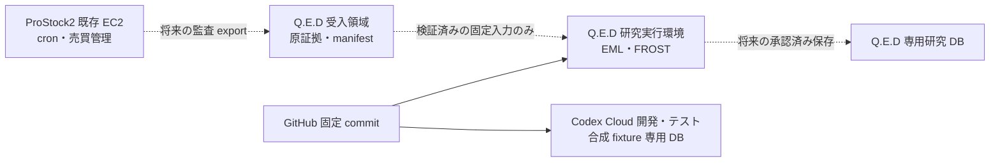

# Q.E.D 実行環境分離・配置計画 — Phase 5R Task A

調査日: 2026-10-17。調査基準は `main` の
`a3e63907c2f529f289101698ee7d62f8bf72f436`。本資料は配置と依存関係の監査・提案であり、
環境構築、外部データ取得、DB migration、売買接続を実施した記録ではない。

## 1. 確定している配置と停止条件

- ProStock2 の既存 EC2 に Q.E.D のコード、PostgreSQL、EML・FROST 実行環境は存在しない。
  Q.E.D が既存 EC2 上で稼働済みという前提は採らない。既存 cron・売買管理の変更は行わない。
- Q.E.D のソースと Draft PR #1〜#3 は GitHub に保存されている。
- 実運用 DB、実 FROST 履歴、全探索 N、コスト後 OOS リターンの取得先・責任者・権限は未確定。
  親アプリの正式スキーマも未取得である。
- Codex Cloud の PostgreSQL はソフトウェアの機能検証用である。合成 fixture、最小外部スタブ、
  テスト生成 run を含み、ProStock2 の本番履歴・実データ・過去の探索 N の証拠として使わない。
- 親スキーマに依存する既存の PostgreSQL 統合テスト 7 件は引き続き **Hold／実結合未検証**。
  スタブを増やして実結合成功とは扱わない。
- NOTE-008 の採用評価は実データと全探索 N の受領まで **Hold**。DSR・PBO・既存 FROST
  ポリシー、既存 baseline、main、実売買との接続は変更しない。

旧 `docs/runbooks/event_study_pipeline_runbook.md` 冒頭の
「EC2 t3.micro (30 GB gp3), PostgreSQL (qed_dev)」や README の `~/prostock` 配置例は、
現在の実配置を証明しない。今回の確定事項と矛盾する配置説明には本資料を優先する。

## 2. 開発・受入・将来の研究環境を分離する



破線は未実装・未接続の将来経路。実売買への戻り経路は設けない。

| 環境 | 入力・資格情報・永続化 | 現在の利用範囲 |
|---|---|---|
| ProStock2 既存 EC2 | 既存アプリが所有。Q.E.D の Python・PG・ジョブを追加しない | 今回の調査・変更対象外。将来の export は独立した承認対象 |
| Codex Cloud 開発 | 固定 Git commit、合成 fixture、専用 localhost PG。開発用資格情報のみ | 単体・機能統合テスト。履歴を本番から継承したと扱わない |
| Q.E.D データ受入 | 別ディレクトリ／バケット・別権限。原証拠、manifest、検証結果、隔離領域を分離 | 今回は契約と純関数のみ。保存・転送・再試行は Task C で実装 |
| Q.E.D 研究実行 | 受入済み固定入力と再現 manifest、専用 DB、制限付き研究 worker | 配置先未決定。実データ取得前の本番評価は禁止 |
| 将来の本番運用 | DB 所有者、ネットワーク、権限、監視・復旧、運用承認が必要 | 未配置・未接続。今回の承認範囲外 |

既存コードを別環境へ固定 commit で配置し、全面再実装しない。接続先と資格情報は環境ごとに
独立させ、本番 DSN をテストの fallback にしない。受入処理は ProStock2 の cron から同期実行せず、
将来の export／転送の失敗を売買管理の成否と結合しない。転送方式・認証・失敗隔離の保証は
Task C が完了するまで未実装である。

## 3. 実行依存関係のコード監査

### Python とツール

| 依存 | コード・資料上の根拠 | 確認状況 |
|---|---|---|
| Python | `event_study_pipeline_runbook.md` §2、`frost_engine.md` §2.2 は 3.10 以上。型記法もそれを前提 | Codex で 3.12.14 を確認。3.10 からの全バージョン互換性は未検証 |
| `numpy`, `pandas` | EML fitness／探索、特徴量、walk-forward、FROST PBO 等 | Codex は numpy 2.5.4、pandas 3.0.6。実測環境情報であり互換範囲の保証ではない |
| `psycopg` 3 | `analytics/python/pg_io/postgres_conn.py`、各 DB writer／bridge | Codex は 3.3.6。psycopg2 への置換はしない |
| `pytest` | `pytest.ini` と `tests/` | Codex は 9.1.1。開発依存であり運用 worker では必須でない |
| `duckdb` | `features/build_event_study_abnormal_return_panel.py` の実 Parquet 読取 | Codex .venv では未導入。実 Parquet 入力経路は今回未実行 |
| `python-dotenv` | `scripts/postgres/run_event_study_writeback.py:18` が無条件 import | Codex .venv では未導入。この入口はそのままでは実行できない |
| PostgreSQL server／`psql` | migration、DB writer、shell 初期化スクリプト | Codex の検証 server は 17.11。別ホストの PG も可能。最低対応メジャーは未確定 |
| Bash／Make／Git | `scripts/postgres/*.sh`、`scripts/frost/*.sh`、Makefile | ラッパーの実行・配置用。受入純関数には不要 |

調査基準 commit には `requirements*.txt`、`pyproject.toml`、依存 lock、Docker 定義、CI workflow が
ない。上記の実測版一覧は lockfile の代わりではない。将来の配置前に、別作業で runtime と test
依存を分けた固定 manifest・OS／PG 版・実行手順を作り、空環境からの再現を検証する。
本資料の監査ではパッケージ導入・版の変更を行っていない。

Task BのSchema試験には、本PRで開発専用 `requirements-contract-test.txt` を追加する。
`jsonschema==4.25.1` はテスト用で、新しいvalidatorの実行時依存はPython標準ライブラリのみ。
これは既存プロジェクト全体のlockではない。上記容量は追加test依存の導入前の測定値である。
米国マクロの時刻照合には版固定したIANA timezone databaseが必要で、DBや市場カレンダーの代用ではない。

### 既存の実行入口と書込み範囲

| 入口 | 必要入力・挙動 | 分離時の扱い |
|---|---|---|
| `scripts/postgres/run_event_study_writeback.py` | Parquet → DuckDB → pandas → event study DB／監査記録 | 実ファイルと依存の検証後、専用研究 DB でのみ実行を検討 |
| `scripts/postgres/run_eml_pipeline.py` | `event_study_summaries` と run、探索、評価、walk-forward、昇格 bridge／監査・台帳保存 | データ受入と独立。今回起動・接続しない |
| `python -m analytics.python.frost.frost_runner` | FROST 候補・固定 policy、DB writer、評価／決定・台帳保存 | 研究環境限定。受入成功を候補採用や昇格に変換しない |
| `scripts/frost/run_frost_meta_validation.py` | candidate JSON、観測用感度分析、任意の `--write-db` | 実データ・全探索 N 未取得により採用評価 Hold |
| `scripts/golden/golden_dataset.py`, `golden_check.py` | DB／CSV／baseline。load は対象表を TRUNCATE する | 専用 golden DB が必要。既存 baseline の生成・再生成を今回行わない |

次の既存挙動は、データ受入を迂回してそのまま研究・本番へ接続できない理由になる。今回それらの
実装や判定式は変更せず、新しい受入境界から自動実行しない。

- `build_event_study_abnormal_return_panel.py:47-57` は DuckDB 未導入・入力不存在時に sample を返す。
  `run_eml_pipeline.py:96-115` は panel を既定 5,000 行へ制限し、`:243-251` は 50 行未満で
  合成データへ置換する。これらを実データの完全性・全期間の証拠として使わない。
- `frost_runner.py:18-19` の **dry-run も DB 書込みを行う**。runs／candidates／evaluations／
  decisions に加え、`:232` 以降で台帳、`:308` 以降で policy も記録する。
  dry-run を本番 DB に接続してよい根拠にしない。
- `scripts/frost/init_frost_tables.sh` は 060〜065 と view の初期化のみであり、全 migration の
  初期化ではない。また DSN を表示する。秘密情報を含む実 DSN でそのまま監査ログへ出さない。
- `Makefile:39` の導入エラー無視、`:234-236` のテスト失敗 fallback は、検証成功の根拠に使わない。
  回帰結果は `python -m pytest` を直接実行し、終了コード・成功／失敗／skip・失敗 ID を保存する。

## 4. PostgreSQL と外部親スキーマ

Q.E.D 内の SQL は JSONB、TIMESTAMPTZ、recursive CTE、UPSERT、PL/pgSQL、trigger、
materialized view、UUID／`gen_random_uuid()` 等を使う。PG 17.11 の機能試験結果から、未検証の
PG メジャーや正式親 DB との互換性まで推定しない。DB セッションは UTC を基準とし、
新規外部受入では naive 日時を拒否する。

| 所有・種類 | 主な依存 | 現在の保証範囲 |
|---|---|---|
| Q.E.D 追加テーブル／view | event study 015〜021、EML 030〜037、FROST 060〜065、causal／genome／scale 070〜081、policy 082〜083、ledger 084、meta validation 085 | ソース DDL は存在。実運用 DB への適用は未実施 |
| PR #1 追加・修正 | 手動試行086、固定capture087、TRUNCATE保護088、評価行registry089 | Draftのみ。全機能は084 → 086 → 087 → 088 → 089。capture単体は084 → 087で086に依存しない。未監査の旧receipt familyは停止し、自動backfillしない |
| 未取得の親オブジェクト | `experiment_runs`, `hypotheses`, `evidence_bundles`, `factor_candidates`, `audit_events`, `_migrations`, `update_updated_at_column()` | 実 DDL・制約・版・権限・所有者が未確定。Q.E.D の推測 SQL から正式スキーマを捏造しない |
| Q.E.D 内にも DDL がある連携対象 | `knowledge_artifacts` (017)、`artifact_links` (018) | 親アプリ側に既存定義があれば列・型・制約の衝突監査が必要 |

主な参照根拠は migration 016 の `experiment_runs` FK、017 の同 FK と更新 trigger、各 migration
の `_migrations`、`postgres_event_study_experiment_report_bridge.py:267-327` の
`evidence_bundles`／`hypotheses`、`postgres_event_study_target_rule_resolver.py` と seed 020 の
`factor_candidates`／`hypotheses`、各 audit writer である。

`tests/integration/test_migrations_apply_pg.py:22-32` の外部テーブルは **最小スタブ** である。
この環境で全 migration を適用できても、親アプリの FK、enum、trigger、RLS、必須列、権限、
運用ライフサイクルを検証したことにはならない。

外部依存 7 件の Hold 対象は
`tests/integration/test_pipeline_integration.py` の次の ID を維持する。今回これらを再実行・skip 化・
xfail 化・成功扱いしていない。Phase 2 の記録と正式親スキーマ取得後に比較する。

1. `TestPhaseBExperimentReport::test_bridge_creates_experiment_run`
2. `TestPhaseBExperimentReport::test_bridge_idempotent`
3. `TestPhaseCKnowledgeArtifact::test_ka_bridge_creates_artifact`
4. `TestPhaseCKnowledgeArtifact::test_ka_bridge_idempotent`
5. `TestPhaseDTargetResolution::test_resolved_when_valid_candidate_code`
6. `TestPhaseDTargetResolution::test_unresolved_when_no_code`
7. `TestUpsertNoDuplicates::test_full_pipeline_rerun_no_duplicates`

## 5. ファイルと容量・計算資源

### 実測値と未取得情報を分ける

2026-10-17 のファイル走査では、基準 commit の追跡対象は 235 files／2,002,258 bytes。
Codex の既存 `.venv` は通常ファイル合計 182,818,449 bytes、テスト PG data directory は
89,085,408 bytes、展開済み PG バイナリ等は 68,389,182 bytes だった。
symlink を除く論理ファイル長の合計であり、ブロック使用量・コンテナ image・OS・本番必要容量の
計測ではない。テスト DB の履歴／試験反復回数にも依存する。**この数値を本番 sizing に換算しない。**

基準 commit の `tests/golden/` にはテストコードがあり、実データ CSV・固定 baseline は追跡されて
いない。実市場データの銘柄数、頻度、期間、revision 数、特徴量数、全探索件数、run 頻度、
全候補 returns の保存粒度、保持期間、圧縮率は未取得である。本番の必要 CPU・RAM・永続容量は
現時点では算定不能。

### 開発開始予算と本番の必要量

| 用途 | 初期の提案 | 条件・未検証点 |
|---|---|---|
| 小規模 fixture の開発 worker＋専用 PG | 2 vCPU、4 GiB RAM、永続 20 GiB を計画上の出発点にする | 実データ処理性能の保証・最小構成の測定ではない。OS／依存 cache は別枠。複数並列 worker 時は再測定 |
| 実データの受入・原証拠保存 | worker と分離した永続 volume／object storage、別の隔離・temp 領域 | 日次転送量、保持・再試行・revision・監査要件が確定するまで容量未決定 |
| EML 全探索・FROST 再評価／メタ検証 | ProStock2 と別の制限付き batch worker、専用研究 PG | 候補数・日数・fold 数・摂動設定数の代表 workload で peak RSS、CPU 時間、temp、I/O、WAL を測定して決定 |
| 本番 DB・可用性 | 未決定 | 所有者、RPO／RTO、backup／復旧試験、保持義務、監視、アクセス制御の決定が先 |

GPU や分散処理を必須とする実装は今回の監査経路では確認していない。だからといって既存
EC2 の余剰資源で安全に動くとは扱わない。資源増量だけで全探索の監査欠落は解消しない。

容量計画は次の変数を受領して作る。数字が不明な項目は unknown のまま残し、0 や推測値で埋めない。

```text
原証拠量 = Σ(実際の受領ファイル bytes × 保存 revision／期間)
市場行数 = Σ(セッションごとの対象銘柄 × バー数)  # 実 calendar・universe を使用
特徴量量 = 行数 × 特徴量数 × 実測 bytes/値 ＋ index／metadata
候補評価行数 = Σ(run ごとの全評価候補 × 評価／設定／fold 数)
returns量 = Σ(必要候補ごとの OOS 観測数 × 保存列 × 実測 bytes/値)
総永続量 = 原証拠 ＋ 正規化物 ＋ DB heap/TOAST/index ＋ WAL
         ＋ 監査/capture ＋ 隔離 ＋ 再試行/temp ＋ backup ＋ 運用余裕
```

圧縮・replica・backup の倍率、最大同時受信数、最大ファイルサイズ、隔離の保持期間、
削除承認方針は未確定。受信原本の上書き防止・原子的保存は Task C で実装してから保証する。

資源を増大させるコード上の根拠:

- `eml_tree.py:54-85` は depth を 2 に抑えても terminal の組合せをリスト構築する。
  `eml_search.py:143-178` は全候補を保持して sort した後に top_k を切る。
- `backtest/harness.py` の fold は net／gross returns、position、cost、slippage の pandas Series を保持する。
- `frost_meta_sensitivity.py:105-130` の Kendall τ-b は候補数に対して O(n²)。摂動回数も処理量を増やす。
- `frost_pbo.py:98-105` は組合せ全体をリスト化してから 256 件へ間引く。
  256 は peak memory の上限ではない。fold 数を増やす workload は実行前に別途 sizing する。
- migration 081 は候補×fold の保存増大を警告し、partition の準備・サイズ監視を定義する。
  partition 化を既に完了したとは扱わず、将来の移行も今回実施しない。

## 6. PR のベース・依存・提案マージ順序

2026-10-17 の GitHub API 確認時点では、全 PR の base は
`a3e63907c2f529f289101698ee7d62f8bf72f436`、open／Draft／unmerged。

| PR | 確認 HEAD | 役割・今回との関係 |
|---|---|---|
| [#1](https://github.com/na19890816-cell/Q.E.D/pull/1) | `fbb0ef26a5a5f889dedf9aeed8d858635da68aa0` | ADR-002 S3、重複防止、DB append-only、固定 capture。通常 as-of の遅延 commit 問題を全面解消したとは扱わない |
| [#2](https://github.com/na19890816-cell/Q.E.D/pull/2) | `99604b427716a760a949d85b311f4ecb9728804c` | main 起点の独立テスト基盤修正。正式親 schema 未取得の 7 件は Hold |
| [#3](https://github.com/na19890816-cell/Q.E.D/pull/3) | `44c974b585f292e91d62de3f7bb8b7b3a3343c11` | main 起点の独立研究準備。NOTE-008 は実データ未取得 Hold |
| Phase 5R Task A/B の本 PR | main 起点の独立 branch `feat/phase5r-deployment-data-contract` | 配置監査と純関数のデータ契約。#1〜#3 のコードを取り込まず、実行依存も追加しない |

人間が採用する場合の提案順は **#2 → #1 → #3 → 本 PR**。先にテストの固定パス問題と
未検証外部結合の表示を整理し、その基盤で台帳を再確認し、研究の停止条件・受入境界を採用する。
技術的にはすべて同じ main 基準の独立 PR であり、stacked PR ではない。本 PR の純関数を
使うために #1 を先に実行する必要はない。順番は採用・レビューの整理案である。

各マージの前に、人間の承認、更新後 base に対する差分確認・必要な rebase、対象回帰、失敗 ID の
比較を行う。重なる docs・ledger・test の衝突を機械的に解決して通過扱いしない。
全 Draft を維持し、本作業ではマージ、Draft 解除、base 変更を実施しない。

## 7. 実 DB 結合・研究再開に必要な情報

1. データ提供者・所有者、取得先、読取／export 権限、許容する転送方式。秘密情報は GitHub に保存しない。
2. 正式親 DDL と migration version、schema 名、型・enum・必須列・FK・trigger・RLS、監査仕様、匿名化済み正規 fixture。
3. 非生存・拒否・失敗・保存前除外を含む全候補／評価／選抜履歴、family／policy／code の版、重み・閾値の設定履歴。
4. ADR-002 の N_raw と照合できる全探索記録、再評価・派生の帰属、未記録試行の範囲。
   過去不明の N を 0／1 で補完しない。
5. universe・実取引 calendar・頻度・期間、改定 vintage、公開／受信／利用可能時刻の証拠、必要なデータ品質 status。
6. 候補ごとのコスト後 OOS returns、コスト・slippage の定義、期間分離、CPCV／bootstrap に必要な時系列。
7. 受領量と保持方針、最大ファイル・run 数、復旧目標、backup、監視、DB／storage の責任分界。

今回の Go は **独立した受入契約のソフトウェア品質検証** まで。Task C の保存／転送／障害隔離、
Task D の全探索保存の監査・不足対応は後続であり、ここでは完了と報告しない。
親 DB 実結合と NOTE-008 の統計的エッジ採用は **Hold** を維持する。
